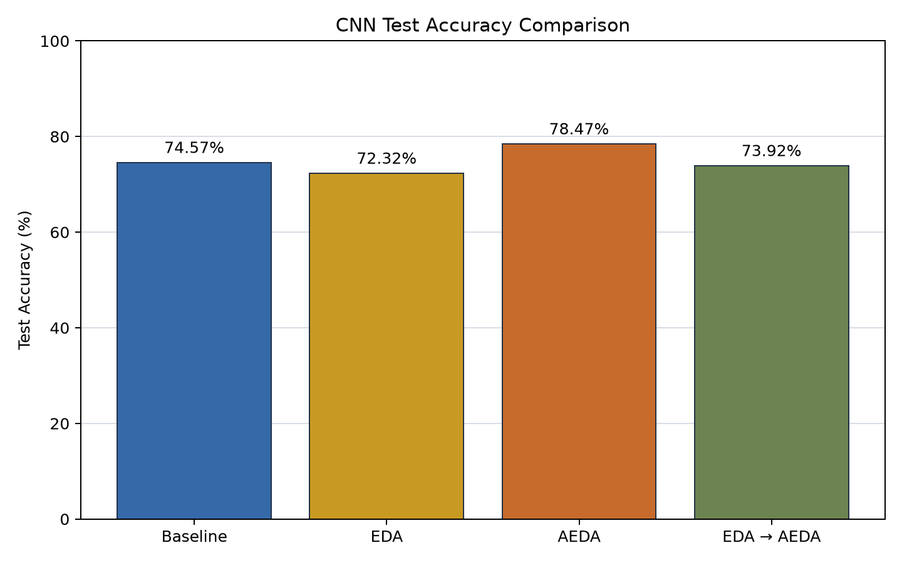
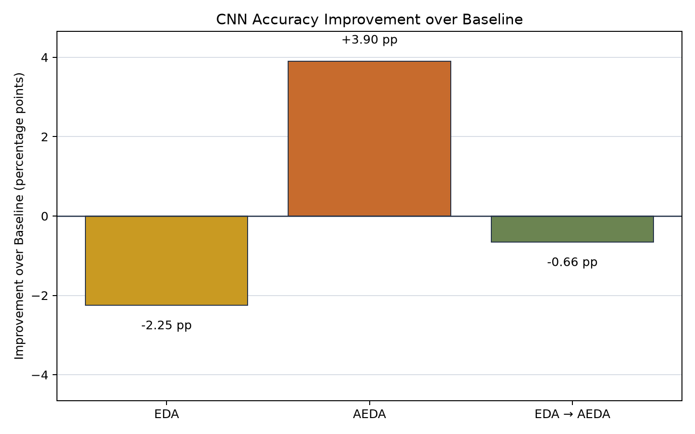
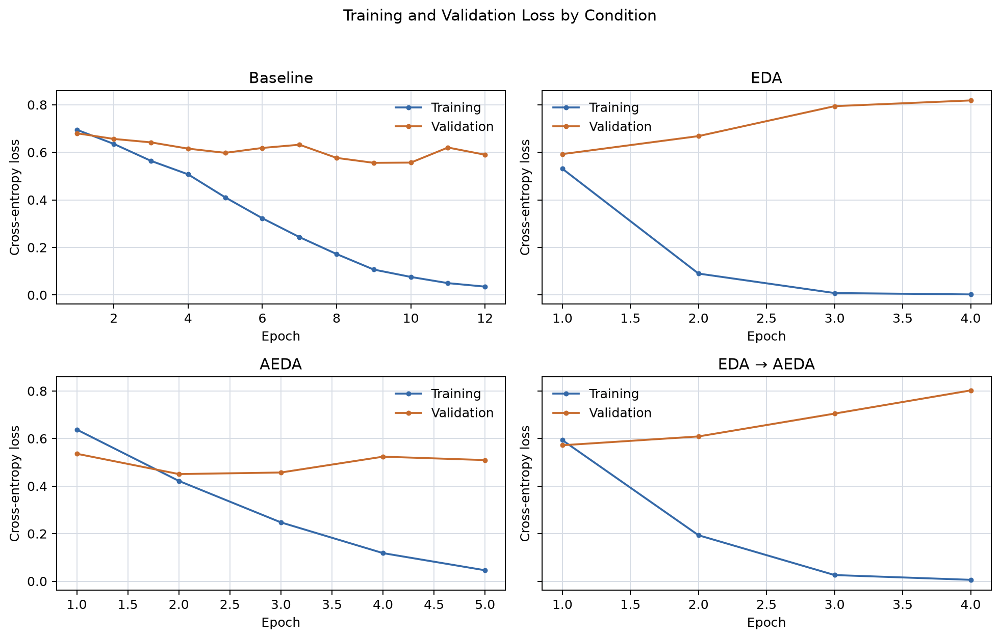

# STAT 453 Final Project — CNN Experiment A

## Project Overview

This archive contains the completed, single seed CNN comparison for *Addressing Data Scarcity with Text Perturbations*. It includes the experiment code, source linked data preparation records, full precision results, three figures, and the four checkpoints used for test evaluation. The [experiment summary](Experiment_A_Results.md) and [generated run report](results/EXPERIMENT_A_REPORT.md) provide additional details. The five original data and augmentation files remain at the repository root.

## Experimental Methods

All four conditions use the same architecture, tokenizer, fixed validation set, test set, model initialization, and training configuration. Only the training corpus differs:

| Condition | Training data and preparation |
|---|---|
| Baseline | Original `sst2_train_500.txt` sources allocated to training; no augmentation. |
| EDA | Existing `lol.txt` EDA rows linked to the training sources. |
| AEDA | Official AEDA SST-2 training sources, augmented once with the official punctuation insertion function, then sampled and balanced. |
| Sequential EDA → AEDA | Existing `aeda_lol.txt` rows derived from EDA followed by punctuation insertion, linked to the training sources. |

The EDA and sequential files were retained as supplied; AEDA was produced with the official [AEDA implementation](https://github.com/akkarimi/aeda_nlp/blob/1da841f683599886961890e32ba3cbed1013c79d/code/aeda.py). The complete 3,000 row AEDA candidate record, including each original sentence, source index, augmentation, and selection flag, is in [aeda_candidate_manifest.csv](results/aeda_candidate_manifest.csv).

## Dataset Description

The 500 source sentences were divided once with seed 42 into 450 training sources (220 negative, 230 positive) and 50 shared, unaugmented validation sources (24 negative, 26 positive). The common, unaugmented official AEDA SST-2 test set contains 1,821 examples (912 negative, 909 positive). Each augmented condition began with 3,000 candidate rows and used 2,700 fitting rows (1,320 negative, 1,380 positive) after source filtering and class matching.

The AEDA source pool contains 7,791 original sentences. Before candidate sampling, 33 sources overlapping the common validation or test data under canonical or punctuation insensitive normalization were excluded. The final training sets have zero canonical and punctuation insensitive text overlaps with validation and test. Audit details are in [dataset_summary.csv](results/dataset_summary.csv), [overlap_report.csv](results/overlap_report.csv), [source_split_manifest.csv](results/source_split_manifest.csv), and [data_preparation_manifest.json](results/data_preparation_manifest.json). The exact prepared fitting and evaluation rows are archived in [results/prepared/](results/prepared/).

The AEDA original source pool is substantially larger than the 500 source pool used by Baseline, EDA, and Sequential EDA → AEDA. Consequently, the AEDA accuracy difference cannot be attributed solely to punctuation augmentation.

## CNN Architecture

Each model uses frozen Stanford GloVe 6B 300d vectors, a one dimensional convolution with 128 filters and kernel size 5, ReLU, global max pooling, a 20 unit dense layer with ReLU, and two raw output logits. `CrossEntropyLoss` consumes the logits directly. A shared fitting vocabulary is built from the union of the four training sets; validation and test data are excluded from vocabulary construction. Sequences are padded or truncated to 50 tokens. The tokenizer retains punctuation as separate tokens; all six AEDA insertion marks have GloVe vectors in this run. See [punctuation_check.csv](results/punctuation_check.csv) and [text_quality.csv](results/text_quality.csv) for counts, OOV rates, and truncation effects.

## Training Configuration

| Setting | Value |
|---|---|
| Framework | PyTorch |
| Optimizer / learning rate | Adam / 0.001 |
| Loss | CrossEntropyLoss |
| Batch size | 64 |
| Maximum epochs | 30 |
| Early stopping | Validation loss, patience 3 |
| Seed | 42 |
| Embeddings | Stanford GloVe 6B 300d, frozen |
| Input length | 50 tokens |
| Initial weights | Identical for all four CNNs |

Each condition was trained once. The checkpoint with the lowest validation loss was restored for evaluation on the common test set. The exact run configuration is in [run_configuration.json](results/run_configuration.json), epoch losses are in [history_*.csv](results/), and the model states are in [checkpoints/](checkpoints/), including `initial_state.pt`. Each best checkpoint is approximately 12.3 MB. No GloVe archive or vectors are committed.

## Experiment Execution

The completed run used the scripts in [cnn_experiments/](cnn_experiments/): `prepare_data.py` created the source split and AEDA candidate sample; `dataset.py`, `text_utils.py`, and `embeddings.py` built common inputs; `model.py` implemented the CNN; `train.py` and `evaluate.py` performed fitting and scoring; `run_experiments.py` orchestrated the four conditions and generated the CSVs and figures. `smoke_test.py` verified punctuation tokenization, forward inference, and backpropagation. The existing results were generated on CPU with Python 3.12.7, PyTorch 2.12.0+cpu, NumPy 1.26.4, scikit-learn 1.5.1, and Matplotlib 3.11.2.

The archived results below are from the completed run. The [full precision metrics](results/metrics.csv) also record best epoch, validation loss, test loss, training time, and the corresponding checkpoint path.

## Results and Accuracy Comparison

| Method | Train samples | Best epoch | Test accuracy | Improvement vs. Baseline |
|---|---:|---:|---:|---:|
| Baseline | 450 | 9 | 74.57% | — |
| EDA | 2,700 | 1 | 72.32% | −2.25 pp |
| AEDA | 2,700 | 2 | 78.47% | +3.90 pp |
| EDA → AEDA | 2,700 | 1 | 73.92% | −0.66 pp |

Using unrounded values in [metrics.csv](results/metrics.csv), Sequential − EDA is +1.59 pp, Sequential − AEDA is −4.56 pp, and AEDA − EDA is +6.15 pp. The exact differences are in [pairwise_differences.csv](results/pairwise_differences.csv). AEDA has the highest observed test accuracy in this one run; these results do not establish statistical significance.







## Comparison with the Original EDA Paper

Wei and Zou (2019), [Table 2](https://aclanthology.org/D19-1670.pdf), report these CNN values for N=500:

| Original paper, CNN | Accuracy |
|---|---:|
| Without EDA | 78.6% |
| With EDA | 80.7% |

The paper's gain is +2.1 percentage points, while EDA in this Experiment A run changed accuracy by −2.25 percentage points relative to our own Baseline. The paper's Table 2 values average five classification tasks and five random seeds; they are not SST-2 only scores. Our run uses one seed, 450 training sources after holding out validation, a different GloVe corpus (6B rather than the reference code's 840B), a PyTorch implementation, and different batch and training choices. The [paper_reference.csv](results/paper_reference.csv) retains all four reported training sizes. The paper figures are context for the trend, not an exact replication benchmark.

## Reproduction Instructions

Use a checkout containing `CNN-Test/`. Clone the official AEDA repository **beside** this repository and check out the revision used in this run. While the pull request is open, select `cnn-test-upload` after cloning the project repository; after merge, use `main` and skip the two branch selection commands.

```powershell
git clone https://github.com/byouyang/STAT453-Final-Project-EDA-AEDA.git
git -C STAT453-Final-Project-EDA-AEDA fetch origin cnn-test-upload
git -C STAT453-Final-Project-EDA-AEDA switch cnn-test-upload
git clone https://github.com/akkarimi/aeda_nlp.git aeda_nlp_reference
git -C aeda_nlp_reference checkout 1da841f683599886961890e32ba3cbed1013c79d
cd STAT453-Final-Project-EDA-AEDA/CNN-Test
python -m pip install -r cnn_experiments/requirements.txt
python -m cnn_experiments.download_glove
python -m cnn_experiments.smoke_test
python -m cnn_experiments.prepare_data
python -m cnn_experiments.run_experiments --skip-prepare
```

`download_glove.py` saves the 300d vectors under `CNN-Test/data/embeddings/`, which Git ignores. Running the final command trains the four models and overwrites this clone's archived outputs, so use a separate working clone when reproducing the results. Run `python -m cnn_experiments.prepare_data --aeda-repo PATH` if the AEDA checkout is elsewhere.

## Limitations

This is a single fixed seed comparison without error bars or statistical significance testing. AEDA draws from a different, much larger original SST-2 training pool than the other methods, so the result combines source scope and augmentation effects. The 50 example validation set is small, and 70 of the 2,700 AEDA training sentences exceed the 50 token limit, truncating 437 tokens; these details are in [text_quality.csv](results/text_quality.csv). Differences from the original EDA paper's data, embeddings, implementation, training scale, and multiple seed averaging limit direct comparability.

