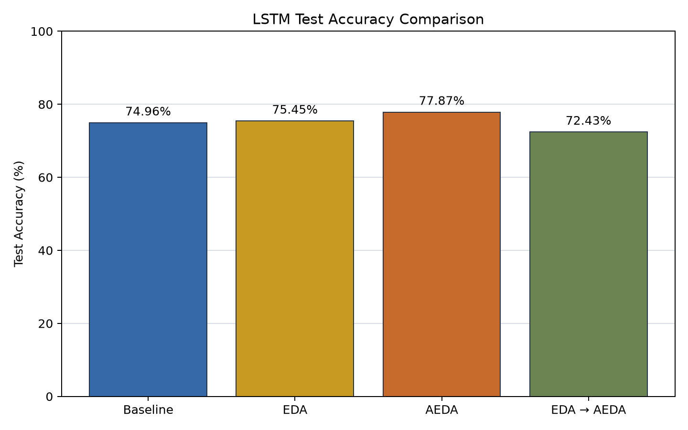
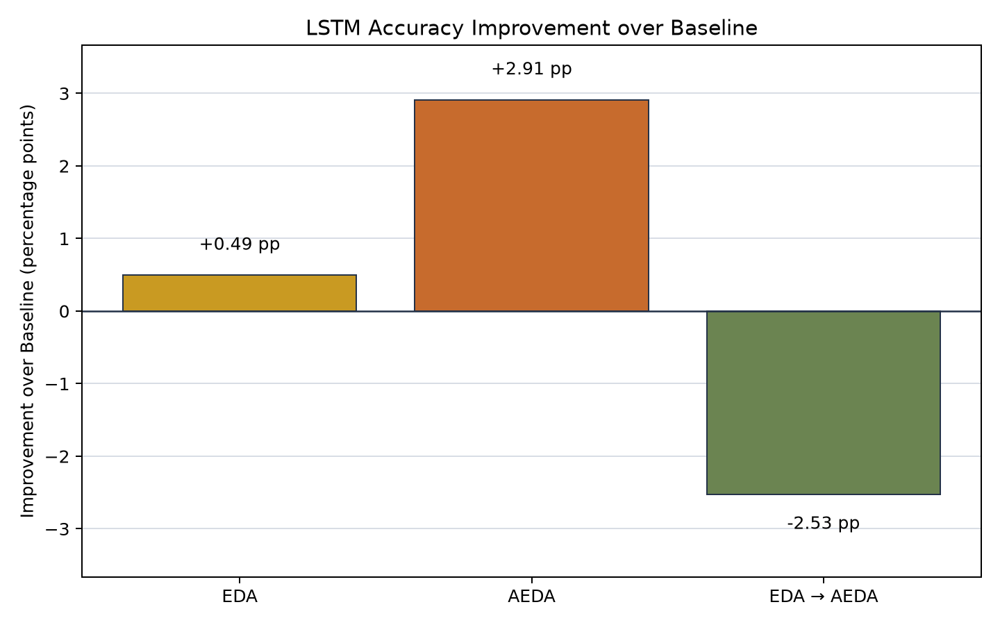
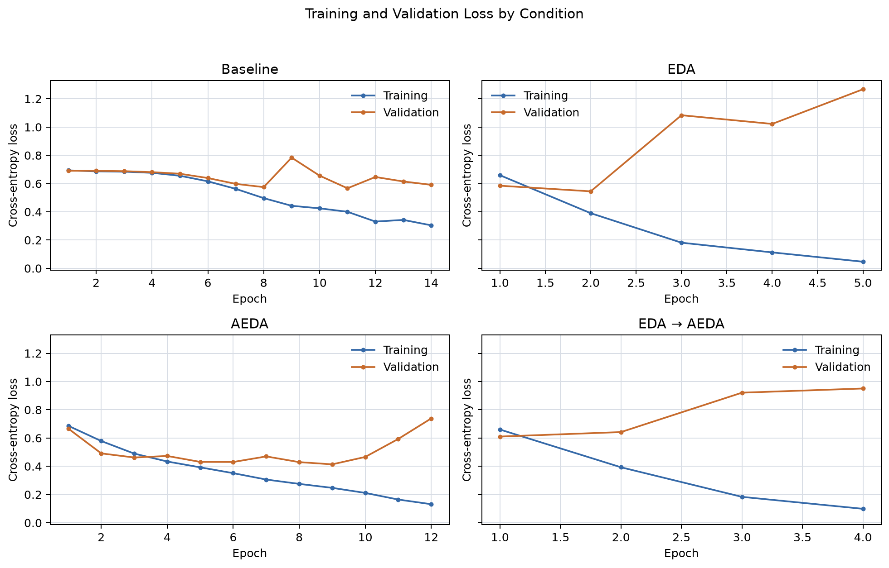

# STAT 453 Final Project — LSTM Experiment A

## Project Overview

This archive contains the completed, single seed LSTM comparison for *Addressing Data Scarcity with Text Perturbations*. It includes the experiment code, source linked data preparation records, full precision results, three figures, and the four checkpoints used for test evaluation. The [generated run report](results/EXPERIMENT_A_REPORT.md) provides additional details. The experiment classifies SST-2 movie-review sentences as positive or negative and uses the exact fitting, validation, and test rows from the group's [CNN experiment](../CNN-Test/README.md).

## Experimental Methods

All four conditions use the same architecture, tokenizer, fixed validation set, test set, model initialization, and training configuration. Only the training corpus differs:

| Condition | Training data and preparation |
|---|---|
| Baseline | Original `sst2_train_500.txt` sources allocated to training in the CNN experiment; no augmentation. |
| EDA | Archived EDA rows linked to the training sources, originally prepared from `lol.txt` in the CNN experiment. |
| AEDA | Official AEDA SST-2 training sources, augmented once with the official punctuation insertion function, then sampled and balanced in the CNN experiment. |
| Sequential EDA → AEDA | Archived rows derived from EDA followed by punctuation insertion, originally prepared from `aeda_lol.txt` in the CNN experiment. |

The LSTM preparation step copies the six prepared CNN splits byte for byte and rechecks class counts, text overlaps, and validation-source siblings. It does not resample or regenerate augmentations. Source paths, row counts, and SHA-256 hashes are recorded in [data_preparation_manifest.json](results/data_preparation_manifest.json). The original preparation history is preserved in [cnn_data_preparation_manifest.json](results/cnn_data_preparation_manifest.json); its source paths refer to the original CNN directory layout.

The original AEDA rows were produced with the official [AEDA implementation](https://github.com/akkarimi/aeda_nlp/blob/1da841f683599886961890e32ba3cbed1013c79d/code/aeda.py). The complete 3,000 row candidate record, including each original sentence, source index, augmentation, and selection flag, remains in the CNN archive's [aeda_candidate_manifest.csv](../CNN-Test/results/aeda_candidate_manifest.csv).

## Dataset Description

The 500 source sentences were divided once with seed 42 into 450 training sources (220 negative, 230 positive) and 50 shared, unaugmented validation sources (24 negative, 26 positive). The common, unaugmented official AEDA SST-2 test set contains 1,821 examples (912 negative, 909 positive). Each augmented condition began with 3,000 candidate rows and used 2,700 fitting rows (1,320 negative, 1,380 positive) after source filtering and class matching.

The original CNN preparation used an AEDA pool of 7,791 source sentences and excluded 33 sources overlapping the common validation or test data under canonical or punctuation insensitive normalization before candidate sampling. The reused LSTM training sets have zero canonical and punctuation insensitive text overlaps with validation and test. Audit details are in [dataset_summary.csv](results/dataset_summary.csv), [overlap_report.csv](results/overlap_report.csv), and the original [source_split_manifest.csv](../CNN-Test/results/source_split_manifest.csv). The exact fitting and evaluation rows are archived in [results/prepared/](results/prepared/).

The AEDA original source pool is substantially larger than the 500 source pool used by Baseline, EDA, and Sequential EDA → AEDA. Consequently, the AEDA accuracy difference cannot be attributed solely to punctuation augmentation.

## LSTM Architecture

Each model uses frozen Stanford GloVe 6B 300d vectors and two stacked bidirectional LSTM layers. The first layer has 64 hidden units per direction and returns the full sequence with 128 features per token. After dropout of 0.5, the second layer uses 32 hidden units per direction. Its final forward and backward states are concatenated into a 64-feature sentence representation, followed by dropout of 0.5, a 20 unit dense layer with ReLU, and two raw output logits. `CrossEntropyLoss` consumes the logits directly.

The recurrent layer sizes, bidirectionality, dropout, and dense layer match `build_model` in the EDA authors' [reference implementation](https://github.com/jasonwei20/eda_nlp/blob/master/experiments/methods.py). This PyTorch version uses packed sequences so padding does not affect either direction's states; the original Keras reference processes fixed-length padded sequences without masking. Raw logits with cross-entropy serve the same classification purpose as the reference's softmax output with categorical cross-entropy. Matching the layer architecture does not reproduce every initialization, implementation, or training detail of the original paper.

A shared fitting vocabulary of 9,583 entries, including padding and unknown tokens, is built from the union of the four training sets; validation and test data are excluded from vocabulary construction. Sequences are padded or truncated to 50 tokens. Unknown words have zero vectors but still count as sequence tokens. The tokenizer retains punctuation as separate tokens; all six AEDA insertion marks have GloVe vectors in this run. See [embedding_metadata.json](results/embedding_metadata.json), [punctuation_check.csv](results/punctuation_check.csv), and [text_quality.csv](results/text_quality.csv) for coverage and truncation details.

## Training Configuration

| Setting | Value |
|---|---|
| Framework | PyTorch |
| Optimizer / learning rate | Adam / 0.001 |
| Loss | CrossEntropyLoss |
| Batch size | 64 |
| Maximum epochs | 30 |
| Early stopping | Validation loss, patience 3 |
| Seed | 42 |
| Embeddings | Stanford GloVe 6B 300d, frozen |
| Input length | 50 tokens |
| Recurrent layers | Bidirectional LSTM: 64 then 32 units per direction |
| Dropout | 0.5 after each bidirectional layer |
| Initial weights | Identical for all four LSTMs |
| Dropout random seed | Reset at the start of each condition |

Each condition was trained once. The checkpoint with the lowest validation loss was restored for evaluation on the common test set. The exact run configuration is in [run_configuration.json](results/run_configuration.json), epoch losses are in [history CSVs](results/), and the model states are in [checkpoints/](checkpoints/), including `initial_state.pt`. Each best checkpoint is approximately 12.4 MB. The GloVe archive and vectors are excluded by `.gitignore`.

## Experiment Execution

The completed run used [run_all.py](run_all.py) and the modules in [lstm_experiments/](lstm_experiments/). The runner handles environment setup, dependencies, smoke checks, data validation, GloVe retrieval, and all four experiments. `prepare_data.py` copies and validates the archived CNN splits; `dataset.py`, `text_utils.py`, and `embeddings.py` build common inputs; `model.py` implements the stacked BiLSTM; `train.py` and `evaluate.py` perform fitting and scoring; `run_experiments.py` generates the CSVs, report, and figures. `smoke_test.py` checks bidirectional states, dropout, padding, punctuation preservation, gradients, frozen embeddings, and checkpoint restoration.

The saved run configuration records CPU execution with PyTorch 2.15.0+cpu. The [full precision metrics](results/metrics.csv) record best epoch, validation loss, test loss, training time, and checkpoint path for each condition. The results below are from this completed run.

## Results and Accuracy Comparison

| Method | Train samples | Best epoch | Test accuracy | Improvement vs. Baseline |
|---|---:|---:|---:|---:|
| Baseline | 450 | 11 | 74.96% | — |
| EDA | 2,700 | 2 | 75.45% | +0.49 pp |
| AEDA | 2,700 | 9 | 77.87% | +2.91 pp |
| EDA → AEDA | 2,700 | 1 | 72.43% | −2.53 pp |

Using unrounded values in [metrics.csv](results/metrics.csv), Sequential − EDA is −3.02 pp, Sequential − AEDA is −5.44 pp, and AEDA − EDA is +2.42 pp. The exact differences are in [pairwise_differences.csv](results/pairwise_differences.csv). AEDA has the highest observed test accuracy in this run. EDA provides a small improvement over Baseline, while the sequential combination performs below all three other conditions. These results do not establish statistical significance.







## Comparison with the Original EDA Paper

Wei and Zou (2019), [Table 2](https://aclanthology.org/D19-1670.pdf), report these RNN values for N=500:

| Original paper, RNN | Accuracy |
|---|---:|
| Without EDA | 75.3% |
| With EDA | 79.1% |

The paper's gain is +3.8 percentage points, while EDA in this LSTM Experiment A run changed accuracy by +0.49 percentage points relative to our own Baseline. The paper's Table 2 values average five classification tasks and five random seeds; they are not SST-2 only scores. Our run uses one seed, 450 training sources after holding out validation, a different GloVe corpus (6B rather than the reference code's 840B), a PyTorch implementation with packed sequences, and different batch and training choices. Although the recurrent layer architecture matches the reference, the paper figures are context for the trend rather than an exact replication benchmark.

## Comparison with the CNN Experiment

Both experiments use the same fitting, validation, and test rows, tokenizer, frozen GloVe 6B 300d embeddings, and principal training settings. Their model architectures and recorded PyTorch versions differ. The full precision comparison is in [cnn_lstm_comparison.csv](results/cnn_lstm_comparison.csv).

| Method | CNN test accuracy | LSTM test accuracy | LSTM − CNN |
|---|---:|---:|---:|
| Baseline | 74.57% | 74.96% | +0.38 pp |
| EDA | 72.32% | 75.45% | +3.13 pp |
| AEDA | 78.47% | 77.87% | −0.60 pp |
| EDA → AEDA | 73.92% | 72.43% | −1.48 pp |

The LSTM scores higher for Baseline and EDA, while the CNN scores higher for AEDA and the sequential combination. AEDA is the highest-scoring condition within both architectures. Differences are calculated from unrounded accuracies and describe these individual runs; they do not establish that one architecture is generally better.

## Reproduction Instructions

Use a checkout containing both `LSTM-Test/` and the archived `CNN-Test/results/prepared/` splits. Python 3.10 or newer is required; Python 3.12 is recommended to align with the CNN setup. From the repository root, one command runs the complete LSTM workflow:

```powershell
python .\LSTM-Test\run_all.py
```

From the enclosing `FinalProject` directory, use:

```powershell
python .\STAT453-Final-Project-EDA-AEDA\LSTM-Test\run_all.py
```

The runner creates `LSTM-Test/.venv`, installs dependencies, checks the model and data, reuses available GloVe vectors or downloads them, trains all four models, and writes the results. CPU is the default. The first GloVe download is approximately 862 MB; allow several GB of free space for dependencies, the archive, and extracted vectors. A separate official AEDA checkout and the original augmentation filenames are not required because the prepared CNN splits are reused.

Optional commands from the repository root:

```powershell
# Validate the model and data without GloVe download or experiment training.
python .\LSTM-Test\run_all.py --check-only

# Reuse existing Stanford GloVe 6B 300d vectors.
python .\LSTM-Test\run_all.py --glove-path "C:\path\to\glove.6B.300d.txt"

# Use an active environment with torch, numpy, and matplotlib installed.
python .\LSTM-Test\run_all.py --use-current-python

# Use a CUDA-capable PyTorch installation and GPU.
python .\LSTM-Test\run_all.py --use-current-python --device cuda
```

Downloaded vectors are saved under `LSTM-Test/data/embeddings/`, which Git ignores. The runner can also reuse vectors under `CNN-Test/data/embeddings/`. A full run overwrites the LSTM results, plots, and checkpoints, so use a separate working copy when reproducing the archived run. Dependencies use minimum-version requirements; later installations or different hardware may produce different results.

## Limitations

This is a single fixed seed comparison without error bars or statistical significance testing. AEDA draws from a different, much larger original SST-2 training pool than the other methods, so the result combines source scope and augmentation effects. The 50 example validation set is small, and 70 of the 2,700 AEDA training sentences exceed the 50 token limit, truncating 437 tokens; these details are in [text_quality.csv](results/text_quality.csv). Differences from the original EDA paper's data, embeddings, padding handling, initialization, training scale, and multiple seed averaging limit direct comparability. The CNN comparison uses matched data but separate single runs and different software versions, so architecture differences should also be interpreted descriptively.
